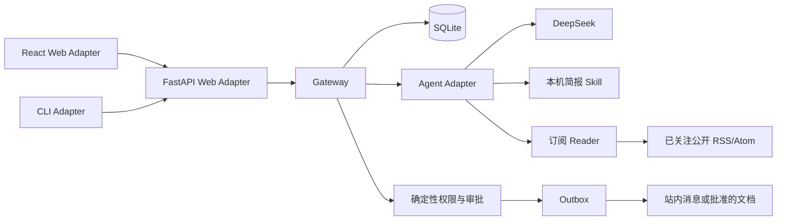

# Navi 架构与运行边界

Web Adapter 位于 `backend/navi/web.py`；CLI Adapter 位于 `backend/navi/cli.py`。二者通过相同本机 HTTP 服务访问 `gateway.py`，不会各自启动调度器或维护第二份业务状态。用户只有 `local-user`，面向本机单用户场景。

`storage.py` 封装 SQLite 连接、事务和模式，采用 WAL。用户、会话、消息、个人条目、任务、调度、作业、尝试、扩展调用、动作、审批、Outbox、投递、用量与审计通过稳定 ID 关联。内部个人条目以 JSON 保存，外部行动单独保存具体目标、内容与哈希。

`gateway.py` 负责排期、作业状态、预算和副作用。调度触发与推进下次时间在一个事务中完成，触发键含调度 ID 和到期时间，并具有唯一约束。恢复时最多创建最近一次到期作业，审计记录错过的周期。任务编辑只改变未来触发；已创建作业保留指令、模型、策略、扩展名称与说明快照。

调度循环与单作业执行循环独立运行，因此等待 DeepSeek 时仍可取消、审批或查询。默认只重试暂时网络或服务错误，最多两次，尝试记录属于原作业。期限从首次领取开始跨重试保留。正常停止把进行中作业保存为等待恢复，异常中断由下次启动处理。取消状态优先，不恢复已取消作业。

`agent.py` 负责模型轮次、工具参数验证、实际扩展调用及上下文。`model.py` 将 Messages 或 Chat Completions 流翻译为统一文本与工具块，API 错误形成失败作业。生产运行没有离线替身入口。离线替身只存在于 `engineering/verification/tests/`，证据明确标为 `offline-test-double`。

`skills.py` 加载真实 `SKILL.md` 和 `data/check_items.json`。`priority_briefing` 选择未完成且重要程度至少为 2 的事项；`deadline_briefing` 选择未来 48 小时及已逾期事项。接口相同，配置切换后的新作业使用新筛选，运行中作业使用旧快照。Heartbeat 空结果或未变化会记录静默，无模型调用、无通知。

`feeds.py` 保留三个英文官方来源并支持用户确认的公开 HTTPS RSS/Atom。自定义来源预览与确认分别实际读取，规范地址重复时沿用稳定 ID，暂停不删除资料。订阅读取单源 12 秒、2MB，整体最多三路并发、60 秒，成功源与失败源各自记录。每源选最新三条；标题、链接和发布时间构成稳定 ID。重复刷新更新同一条目，刷新无需模型。外部文本作为数据，不能改变权限，也不会收到模型密钥。没有截止时间的 RSS 不进入截止工作流。

`feed_http.py` 在实际 HTTPX/httpcore 连接处校验并固定公开目标 IP，TLS 验证原主机名；自定义 URL、补读文章和图片仅允许无认证 HTTPS 443，拒绝全部非公开 DNS 地址、环境代理和重定向。自动动态最多读取十二条、24000 字符资料，每条正文最多 2000；必要时仅补读订阅提供的五篇公开文章，三路并发、整体 30 秒，保留实际 read_scope/read_at。模型不能自编正文 URL 或图片，来源与图片由对应真实材料回填。

`GET /api/feed/items` 按 created/id 倒序使用绑定参数的游标，每页默认二十条、最多五十条；snapshot 可选择限制动态数量，CLI 原默认保持。`GET /api/feed-media/{asset_id}` 仅接受已发布动态引用的 64 位十六进制 ID，由存储记录反查 URL；12 秒、5MB、最多三路并发，校验 MIME 和实际文件头，只返回 JPEG/PNG/WebP/GIF，私有缓存一天，不维护长期图片库。分页及图片读取无需模型。聊天发送时 Gateway 重新校验动态 ID 并引用当前持久正文及 source_ids，失效引用返回错误，前端保留草稿。

模型可以保存明确授权的记忆和目标、更新已有目标、按标题检索与明确解封会话、安排任务和准备文档提案。分类讨论及明确“不保存”的讨论不授权创建目标。update_goal 逐次核对当前请求唯一目标与 body/next_step/state 字段，否定、引用、询问及模型夹带字段拒绝整次调用，到期任务禁止该工具。提醒仅在当前请求明确关联目标或紧接当前提醒追问的时间回复时关联，旧 followup/config 不强制关联。Heartbeat 创建事务仅对 active/paused 判重。Feed 和构想生成只提供读取工具，Gateway 另有确定性工具守卫，不能由关注说明触发保存、调度或外部行动。模型只能提出外部导出，不能直接写文件。权限规则位于 Gateway，模型无权关闭它们。站内提醒日常自动授权与严格人工审批共用同一条持久化链路。

审批事务检查动作仍为待批且哈希一致，保存决定后才创建 Outbox。拒绝不创建 Outbox。内部消息在同一事务中写入通知、投递与完成状态，Outbox 与投递具有唯一约束。文档使用动作 ID 加合法文件名，禁止覆盖；若文件已存在，只有字节一致才可核对恢复，不一致记录 `uncertain`，停止盲目重试。

会话模式版本为 2。唯一索引保证一个主对话，Gateway 统一保护主对话。旧会话保持原标题、消息和摘要并成为副对话，迁移前使用 SQLite backup 保存原数据库。只依据已存在的作业关系补动作来源，不猜测其他历史关联。

新投递消息记录原始会话、实际会话和唯一 Outbox ID。实际投递事务读取原始话题当前状态，封存时转主对话并标明来源，解封后回原话题。严格策略先保存中性的待审回执，获准后才产生实际提醒消息；旧通知仅在历史中保留，不复制为新聊天。

删除先以事务标记 deleting、取消本话题调度及未完成作业、使未决动作和待投递 Outbox 失效，再等待可取消执行停止，最后移除会话消息与摘要并断开作业和任务的会话外键。同步文件投递持有写事务直至写入结束，删除等待其完成。重启继续收尾 deleting 状态，不恢复已取消作业；独立保存条目和必要执行记录保留。

动作修改递增版本，内容哈希包含版本，旧内容即使改回也无法使用旧批准哈希。旧版本、批准记录、Outbox 和实际投递通过动作历史接口追溯。Web 原回复与集中索引使用同一动作，全部未决动作和完整标题搜索不受最近作业的数量限制。

会话超过 40 条消息或 16000 字符时，真实模型压缩较早历史，并保留最近 8 条。手动压缩也使用真实模型。摘要附带确定性组装的有效目标、任务和待审批 ID，历史不删除，同一会话 ID 继续。停用、编辑或删除记忆清除缓存摘要，后续个人记忆仅来自有效条目。

启动器用文件锁限制本项目 Gateway 实例，用项目身份、进程 ID、实例 ID 和本机停止凭证核对后优雅停止。服务仅绑定 `127.0.0.1:8766`，拒绝外部 Host、Origin 和非 JSON 修改请求。静态前端由同一进程提供。启动子进程有独立会话、无终端，并将日志写入 `data/gateway.log`。

真实验收在隔离数据目录中运行，调用仍通过日常数据库的预算预约和 usage 回执记账。证据不含凭据。模型输入包含当前会话和有效个人上下文，实际传输范围在设置与使用说明中告知。

2026-10-07 Muse 修改使用两次备份迁移至 schema 4：v3 添加 sessions.display_abstract，v4 添加 sessions.goal_setup_json 和 messages.interaction_json。sessions.summary 仍用于受保护压缩，标题搜索使用字段投影，禁止返回它。首轮成功或旧会话首次打开后排入唯一 session_meta 后台作业，提交时复核手动名称与旧标题。失败不影响聊天。

Gateway.tick 用 ZoneInfo 本地日历计算最近一个已到的 06:00，以 daily:feed:日期 和 daily:ideas:日期 去重，重启只补最近一次。单 worker 优先处理交互作业。结构化输出格式错误最多纠正一次，之后保留旧批；Gateway 在同一事务更新作业与完整批次。模型只提供关联 ID，公开来源和时间由实际读取结果回填。snapshot 只查询有效构想，历史保留 ID 并可读取。自动内容状态由真实作业派生，无新后台服务。

POST /ideas/{id}/start 和 POST /goals/start 接受 request_id，用唯一触发键原子创建会话及作业。POST /sessions/{id}/goal-choices 校验 card_id、choice_id、setup_version 和当前步骤，重复相同选择返回持久回执，过期或冲突为 409。目标保存由 Gateway 直接提交版本确定的草案。POST /goals/{id}/state 支持 complete、cancel、reactivate，结束时只处理实际 goal_id 关联任务及作业，失效未决审批、取消未投递 Outbox，并停止活动执行。事务提交后迟到模型结果再次检查取消状态；已投递及已导出历史保留。恢复仅恢复目标。自然语言取消使用真实工具，重名返回澄清回执。

v2 迁移至 schema 5，增加 jobs.error_code/recovery_count；使用 SQLite backup 保留个人数据库。daily_requests/daily_tokens 默认和本机原 300/300000 迁为 0，继续预约并记录真实及估算用量。自动作业等待连续清醒六十秒；tick 间隔超过三十秒重置观察窗口。网络或睡眠中断沿同一作业在十、三十分钟后最多恢复两次，累计受五次模型、十次工具、60000 tokens 限制，每次执行窗口 180 秒。跨日取消旧等待批次，只补最近 06:00，成功批次不重跑。

Web 搜索指定 scope=all，直接查询标题及已保存消息正文；默认 API/CLI 保持标题范围。用 LOWER/instr 处理字面匹配，标题命中优先，正文取最近匹配消息和最多 160 字片段，包含归档并排除 deleting。Session 字段投影不返回压缩 summary。选中只读加载消息并定位，避免附带 session_meta 作业。搜索几何尺寸固定，首帧用真实近期缓存或等尺寸加载态；鼠标关闭抑制此次程序恢复的可见框，下一次键盘或 blur 清除标记，键盘关闭保留焦点。

前端目标分类确认后才调用引导 API；完成行三秒反馈只影响呈现，任务终止在后端立即提交。目标移除采用取消状态，保留聊天、文件和审计。构想旧启动回执的会话失效返回 410，前端仅对此更新 request_id 并重试一次。FeedPanel 保留分页条目和可见锚点，隐藏或零尺寸时不捕获、恢复滚动位置；目标与动态复用并排布局状态，各自保留生命周期。点击动态讨论仅选现有会话和设置本地待发送引用，发送后才创建聊天作业。
