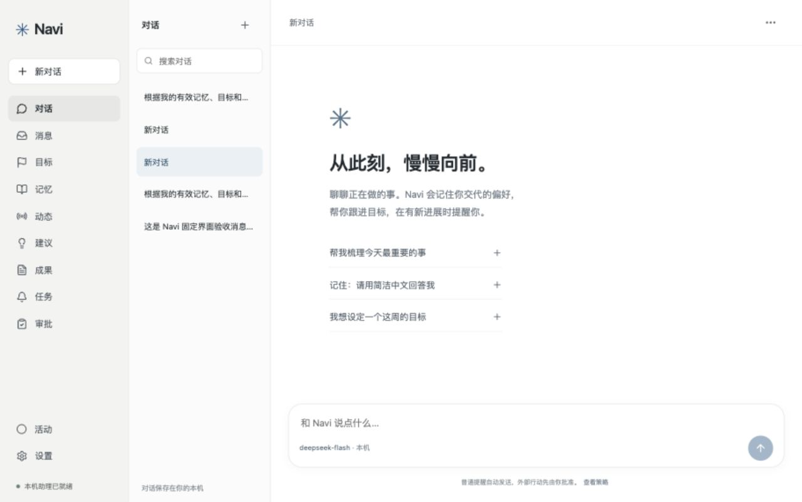

# Navi UX Audit Report

审查日期：2026 年 10 月 2 日，Asia/Taipei。代码基线：`0dd28f5`。本报告依据 engineering/plans/optimize_plan.md，审查当前交付界面的产品体验，未修改产品代码或实施设计方案。

方法：阅读 engineering/plans/Navi_plan.md、engineering/design/DESIGN.md、README.md、架构与验收说明，核对 React 界面和相关后端行为；通过真实界面操作本机 Navi 与 Muse；在 Navi 中完成两轮真实模型对话、历史恢复、搜索、页面浏览、弹窗与下载检查。桌面对照采用 1280 × 802 逻辑尺寸；Navi 另检查 375 × 812 与 320 × 740。Muse 原生截图为 2560 × 1604，按 2 倍像素比例理解布局。

证据分为“本次实测”“源码核对”“已有文档声明”和“设计推断”。这是一位审查者模拟普通用户的体验审查，尚无真实新用户访谈、留存数据或长期跟踪，不能据此断言用户实际流失率。首次使用场景使用现有数据库，没有清空个人状态，也没有重新测试无密钥的全新安装。

Muse 的新建、历史查看、重命名、管理菜单、记忆、目标、动态、讨论入口、构想、成果库和设置均已实际操作。删除入口已找到；临时聊天的最终删除等待当次确认，未执行不可恢复的删除。纯 hover 与键盘 focus 的显示条件未完全分离验证，相关描述限于实际观察到的指针停留及行聚焦状态。Muse 的私人记忆、目标和消息不进入报告、Navi 输入或仓库截图。

## 1. Executive Summary

**当前 Navi 是已有真实助理能力的功能型 MVP，日常使用的产品组织仍有明显断点。** 它能够保存对话、使用记忆与目标、安排后台工作、提出需要批准的动作，并提供带来源的更新和可下载成果。当前界面已具备温和开场、轻量配色和稳定聊天输入区。两轮真实对话分别返回“已收到”和一个合理的澄清问题，说明自然交谈的基本能力成立。

最大的三个体验问题如下。

1. **用户需要先理解系统的模块划分。** 对话、消息、目标、记忆、动态、建议、成果、任务、审批，加上活动和设置，共 11 个导航入口。用户想知道“你帮我推进到哪里了”，需要在多个页面之间寻找和关联信息。页面逐个可用，完整的助理体验仍由用户自行拼接。
2. **最常使用的聊天缺少日常管理与稳定识别。** 会话列表没有时间、预览、重命名、封存或删除入口；标题来自第一句话的前 30 个字符，已有同名与冗长条目。右上角省略号直接触发真实模型压缩，违背常见的“更多操作”预期。聊天越多，找回话题和清理列表的成本越高。
3. **主动帮助的价值没有在原场景中形成闭环。** 消息空状态让用户去开启 Heartbeat；来源引导要求理解工作流；建议会跳到聊天；成果页的“生成简报”只填入指令，而动态页的同名按钮会直接开始生成。状态和下一步分散，用户难以持续感受到一件事情正在得到照顾。

Navi 的 demo 感主要来自功能逐页展示、工程概念进入主流程、测试条目残留，以及操作结果缺少顺手的后续入口。当前页面没有装饰渐变、玻璃卡片或巨大营销区，不能把问题简单归结为颜色与圆角。只替换视觉主题，仍会保留上述断点。

建议方向是保留现有本机架构与权限实现，围绕“聊一件事、继续一件事、查看进展、决定下一步”重新组织界面。设计判断的关键是降低模块选择与信息回忆的负担。[NN/g 的可用性原则](https://www.nngroup.com/articles/ten-usability-heuristics/)支持让状态和可用操作容易识别；它提供评估方法，本报告的具体问题来自 Navi 本次观察。

应保留的有效部分：真实空状态、明确的记忆参与状态、可编辑的下一步、独立的生成与投递状态、来源链接与时间、轻量成果下载、固定底部输入、简洁中文回复。这些已有能力提供了产品化基础。

本次 `./test` 为 **30 passed，1 warning**，警告来自 Starlette 测试客户端的依赖弃用提示。它支持工程基础判断，不能替代产品体验验收。本次没有运行完整 `./test --live`，没有重新验收所有后台恢复与严格审批链路，也没有把已有验收文件当成本次新执行结果。

## 2. First-time User Experience

首次打开现有 Navi，主视区显示“从此刻，慢慢向前。”，说明可交谈、记住偏好、跟进目标与提醒，并提供三个示例。输入框位于底部，用户可以直接输入。这一开场比技术面板自然，已经给出了可理解的定位。

与此同时，左侧完整功能导航和第二列历史一起出现。现有列表中有两个“新对话”、重复的建议生成标题和固定验收内容。普通用户容易先判断“这些条目属于谁”“目标与任务是什么关系”“消息和动态有什么区别”，再开始第一句话。验收数据会加重展示项目的印象；同名标题和缺少管理的结构问题在真实长期使用中仍会出现。

新建聊天有两个入口：主导航“新对话”和会话栏的加号。两者调用同一个操作，均立即保存空会话。重复入口在当前窄小的双侧栏里消耗空间，且多次打开但没有发送会留下更多同名条目。对现有用户而言，全局新建入口有价值；应明确一个主入口，聊天内不再重复强调它，空白编辑阶段也应避免不断增加历史噪音。[源码：新建操作](../../frontend/src/App.tsx:134)，[会话栏](../../frontend/src/App.tsx:190)，[会话持久化](../../backend/navi/gateway.py:65)。

三个开场建议会先填入输入框，用户再发送，这有利于保留用户控制。自然提问“我第一次使用你……请先问我一个必要的问题”得到“请问你今天最想推进的一件事是什么？”，没有编造用户事项。这种对话能力值得成为主体验的中心。

缺少配置时，源码会显示“先连接 DeepSeek”的入口；本次已有密钥，未实测该分支。配置页会让用户面对模型名、接口协议、工作流、优先级阈值等概念。普通用户需要知道怎样完成连接、连接是否成功和接下来能做什么。模型参数可以留在进一步展开的区域，连接结果应以可理解的成功或失败呈现。

初次引导建议保留现有简短文案，在第一次实际委托中完成引导：先问用户今天想推进什么，形成一条明确下一步；用户要求提醒时再解释何时提醒、电脑何时需保持运行、哪些行为需要确认。无需增加强制教程或逐页讲解所有功能。

## 3. Information Architecture Review

当前导航按数据与系统职责组织。各页面文字有一定亲和力，但同一级入口没有区分每天高频事项、偶尔管理事项与运行诊断。认知成本主要来自关系：动态是一份原始更新，建议是一次生成结果，消息是一条投递记录，活动是一次作业记录，它们可能属于同一件事。

| 当前入口 | 用户实际目的与当前问题 | 建议组织 | 体验收益 |
|---|---|---|---|
| 对话 | 交代事情、继续话题；会话管理不足 | 作为默认主空间，历史与当前聊天紧邻 | 打开后立即能继续 |
| 消息、动态、建议 | 看有什么变化、为什么值得注意、能做什么；目前分散 | 统一进入“进展”，保留内容类型和来源 | 一次查看当前需要关注的事 |
| 目标、任务 | 想持续推进一件事；需要自己连接两份列表 | “进展”内按目标查看下一步、提醒和关联结果 | 从事情进入时间安排 |
| 审批 | 对具体动作作决定；当前要专门到另一页 | 原聊天和进展中提供待确认入口，保留完整详情 | 找到提案上下文后再决定 |
| 成果 | 找到可用的文件；来源话题不突出 | 保留独立“成果”，显示关联对话或目标 | 获取结果并知道从哪里继续 |
| 记忆 | 知道助手记住什么、控制其使用 | 从清楚标注的个人资料入口进入，并在记住偏好后提供直达链接 | 管理容易找到，减少主导航负担 |
| 活动、设置 | 排查失败、配置助理 | 放在辅助区域，诊断细节按需展开 | 主流程保持安静 |

这是现有能力的重组方向，尚未实施。一个可评估方案是主导航保留“对话、进展、成果”，个人资料与设置在辅助区域。最终名称和层级需要通过小规模任务测试确认，不能把减少菜单数量本身当成成功。

减少平铺入口时必须保证发现性。记忆管理、失败详情和待确认动作仍需有可识别的文字入口；触屏用户也能看到操作。Muse 的纯图标栏占用更少，但初次使用需要识别图标，直接复制会引入另一种学习成本。保留 Navi 的文字身份和必要标签更合适。

高级选项按需出现能帮助用户先完成常见任务，这是[NN/g 渐进呈现原则](https://www.nngroup.com/articles/progressive-disclosure/)的参考方向。它并不要求把重要风险与授权信息隐藏；具体动作、目标、内容和审批状态仍应完整可见。

## 4. Muse Comparison Table

以下比较只针对本机当前版本与账号状态。Muse 设置显示 Version 4.1；本次没有更新应用。所有内容呈现仅作为交互证据，未核验其中新闻、建议或能力描述的事实正确性。

| 项目 | Navi 当前状态 | Muse 体验 | 改进方向 |
|---|---|---|---|
| 导航 | 206px 文字栏，聊天另有 226px 会话栏，11 个页面入口 | 约 78px 图标栏与约 240px 会话栏；功能页可收起会话栏 | 收紧高频入口；文字标签与空间占用平衡，保留可识别入口 |
| 聊天 | 底部输入、双向气泡、真实回复；新建有两个入口 | 固定输入，角色形象持续可见，副聊天室加号清楚 | 保留 Navi 的身份，通过连续上下文建立熟悉感；无需新增拟人形象 |
| 历史管理 | 标题列表和标题搜索；缺少重命名、封存、删除；无时间预览 | 聊天行指针停留或聚焦时可见时间与省略号；右键菜单有钉选、重命名、封存、删除 | 行尾管理菜单、可识别标题与最近信息；触屏和键盘同样可操作 |
| 记忆 | 独立文字入口；逐条编辑、停用；“不参与回答”清晰 | 从聊天头像到“身分”再到“记忆”，打开 MEMORY.md 编辑界面 | 保留 Navi 的逐条控制；改善来源与生效解释；无需复制文件式管理 |
| 目标 | 当前为空；添加表单包含内容、下一步、状态 | 按追踪、目标与设定目标组织；可直接勾选完成；提供并排聊天 | 强调下一步及最近进展，关联任务不靠用户跨页回忆 |
| 动态 | 来源状态和条目并列，发布时间与检查时间齐全；管理操作比相关性更突出 | 时间段组织，条目有讨论操作；点击讨论打开并排聊天并附引用 | 保留来源时间，在每条更新上解释相关性并支持带上下文讨论 |
| 建议 | 手动生成入口；列表标题重复为“下一步建议”；依据展开为 JSON | 实际进入构想页，保留聊天衔接；本次未评估建议生成质量 | 用具体动作作标题，用自然语言说明依据；可继续讨论 |
| 成果 | 一条已导出验收文档；有详情和直接下载，实际下载成功 | 成果库含分类、最近、搜索、排序和条目菜单 | 先补关联对话与结果状态；只有内容规模增长后再考虑更多分类 |
| 空状态 | 开场亲切；部分说明仅指向另一个模块或 Heartbeat；无匹配历史搜索直接留白 | 新副聊天室很克制，但空白开始的具体提示较少；本次未检查全新账号引导 | 保留真实空状态，为当前任务提供一个明确可执行的开始方式 |
| 微交互 | 常规背景 hover、按压、焦点框；消息无复制菜单；省略号语义不符 | 行尾隐藏管理操作；消息可复制、回复与更多；动态能引用到输入区 | 优先提供任务需要的轻量操作和结果反馈；动画维持克制 |
| 设置 | 费用限制已折叠；模型协议与工作流仍在基础区域 | 独立设置窗口承接更多技术能力，主聊天保持简洁 | 把连接步骤和高级调整分层，准确呈现当前连接状态 |

Muse 提供自然感的可迁移原则是：持续有一个熟悉的交谈对象；次要管理动作靠近其对象出现；查看其他内容时仍可继续对话；状态与时间帮助用户接回上下文。它也有记忆入口较深、图标发现性和内容真实性需要另行核验等限制。Navi 应吸收交互原则，同时保留自己的清楚文字、本机定位和逐条记忆控制。

## 5. Interaction Review

**对话列表与菜单。** Navi 会话行只有打开操作，hover 样式改变背景，源码没有行尾管理按钮。Muse 初始列表较安静；在临时聊天行聚焦或指针停留时观察到时间与省略号。右键菜单实际显示四种管理动作，重命名为 `Navi UX Audit Temporary` 后出现成功反馈。独立的纯鼠标 hover 显示条件仍需进一步核验，不能把行焦点观察扩大为完整 hover 验收。[Navi 会话行](../../frontend/src/App.tsx:192)，[hover 样式](../../frontend/src/App.module.css:142)。

Navi 当前右上角省略号的 title 是“压缩当前会话并保留原始历史”，源码点击后直接提交压缩作业。它有清楚的辅助名称，但普通用户仅看图形会预期更多菜单。应先把管理菜单与上下文维护区分清楚；自动压缩可以继续在后台工作，手动压缩放在有明确名称的高级操作中。本次没有点击该图标购买一次无必要的模型压缩。[源码](../../frontend/src/App.tsx:201)。

**消息区域。** Navi 有“你”和“Navi”的标识，等待时有执行状态，发送后出现停止按钮，完成后恢复发送。两轮简单请求成功，但完成消息没有时间、复制、回复或重新生成入口。需要引用一段回答时只能手动选取文本。优先添加复制与上下文讨论即可，不应为对齐竞品先铺满一排工具。重新生成涉及额外调用与结果替换，应在以后明确需要时再评估。

Muse 的消息区在可访问性结构中提供复制、回复和更多选项；可见截图中的默认阅读状态较安静。这是把低频操作放在对应内容附近的参考。并非所有操作都应该仅靠 hover，键盘 focus 和触屏也必须能使用；新增浮层需能正常关闭和保持可操作。[W3C 对 hover/focus 内容的说明](https://www.w3.org/TR/wcag/#content-on-hover-or-focus)。

**输入区与按钮一致性。** Navi 输入位置稳定，Enter 发送、Shift+Enter 换行及中文组合输入保护在源码中已实现。当前只提供文字输入符合范围，文件、语音和影音入口无需为了丰富界面增加。输入框附近持续显示模型名、“本机”和提醒策略，信息可信但频繁出现会把注意力引向配置。

动态页“生成简报”直接提交并切到聊天；成果页“生成简报”切到聊天并填入指令，仍需用户发送。同名按钮对应两种结果，容易让用户误判是否已经开始。建议为“开始生成”和“准备生成指令”明确区分结果，或统一流程；正在生成、需要确认、可以下载应有各自稳定反馈。[入口实现](../../frontend/src/App.tsx:216)。

**结果与隐藏操作。** Navi 记忆的停用文字说明很有效，编辑与删除图标则一直展示，普通用户需识别图标含义。可将编辑与删除收进带标签的菜单，主要控制保持直达。删除条目源码会直接发出 DELETE，后端直接移除记录；没有恢复机制或确认流程。本次没有删除既有记忆或成果，结论来自源码核对。应提供可撤销删除或明确确认，让操作容易发现的同时保留控制感。[条目操作](../../frontend/src/App.tsx:218)，[删除实现](../../backend/navi/gateway.py:130)。

**状态真实性。** 本次唯一订阅显示“已暂停订阅”。点击刷新后提示“动态已刷新”，旧条目的检查时间仍为 10/2 09:29。后端对停用来源直接跳过，返回空 items 和空 errors；前端只检查 errors 就展示成功提示。改为“当前没有启用的来源，未检查新内容”，并给出恢复来源的操作，会更准确。这是本次复现到的反馈问题。[前端反馈](../../frontend/src/App.tsx:216)，[后端跳过](../../backend/navi/feeds.py:72)。

“本机助理已就绪”由 `/state` 成功决定，含义是本机服务可访问，不能证明模型与预算都可用。本次模型请求成功；无密钥、额度耗尽或模型故障时的显示影响属于源码推断，未在日常数据库里制造失败。可把基础服务、模型连接与具体任务状态分清，让用户看到与眼前操作有关的状态。[状态设置](../../frontend/src/App.tsx:73)。

**空状态。** 消息页的“有值得关注的事，我会告诉你”符合安静助理定位，但后面只说明开启 Heartbeat 或定时任务，没有在原位开始的按钮。目标空状态要求“添加一个目标和下一步”，仍需要用户先掌握表单结构。历史搜索无匹配时甚至没有解释。本次搜索已经存在于回答中的“今天最想推进”，列表空白，因为搜索仅匹配标题。应明确搜索范围、显示无结果解释，并允许清空搜索。[搜索逻辑](../../frontend/src/App.tsx:192)。

**动画与键盘。** CSS 采用 120ms 的指针按压反馈，并尊重 prefers-reduced-motion，符合克制方向；本次没有逐一计时或切换系统减少动态设置。Escape 关闭弹窗可用，但键盘路径实测发现焦点没有返回触发按钮。在 320px 下对“添加任务”按 Enter，标题输入获焦；按 Escape 后 `document.activeElement` 为 BODY。焦点保存发生在弹窗打开后的 effect 中，无法可靠保存原触发位置。应在打开前保存触发对象，关闭后恢复。[焦点实现](../../frontend/src/App.tsx:108)。这次检查不构成完整的 WCAG 合规验收。[W3C 焦点可见原则](https://www.w3.org/WAI/WCAG22/Understanding/focus-visible.html)提供相关设计依据。

## 6. Visual Design Review

**布局比例。** 在 1280px 宽度，实际 DOM 测得主导航 206px、会话栏 226px，合计 432px，占 33.75%。聊天主栏余下 848px；扣除两侧 28px 内边距后，可用阅读宽度约 792px。Muse 对应两栏约 318px，占约 24.8%，聊天可用空间更多。Navi 聊天尚能阅读，问题在于永久导航占用与入口数量一起削弱了聊天的视觉优先级。

Muse 的功能页能够把主要空间交给当前内容，且提供并排聊天。Navi 在离开聊天后移除会话栏，功能页则用“标题、说明、搜索与按钮、列表”重复骨架。统一骨架有助学习，所有页面都以同样强度呈现也容易让目标、记忆和成果像不同数据表。区别应来自用户任务重点：目标突出下一步，记忆突出参与回答的控制，成果突出实际可取用结果。

**字号与阅读。** engineering/design/DESIGN.md 要求正文 16px、行高 1.8；当前实际聊天内容为 15px、行高 27.75px，375px 与 320px 下为 14px。首屏标题为 30px，普通页面标题为 28px。标题没有大到主导整个页面，主要问题是用于说明状态、时间与权限的信息常为 10px 或 11px，且灰度偏浅。与标题形成的差距让重要解释容易被忽略。[聊天正文](../../frontend/src/App.module.css:59)，[说明层级](../../frontend/src/App.module.css:80)。

基于当前 CSS 颜色按 sRGB 相对亮度公式计算，白底上的欢迎说明 `#75808a` 约 4.03:1，条目时间与状态 `#7e8a93` 约 3.53:1，页脚 `#8a949b` 约 3.09:1，发言者 `#858e96` 约 3.33:1。这些承担信息传递的小字低于普通文本 4.5:1 的参考门槛。数值用于定位当前样式问题，尚未扫描全站所有前景背景组合。优先提高状态文字对比度与字号，让安静和可读同时成立。[W3C 普通文本对比度标准](https://www.w3.org/WAI/WCAG22/Understanding/contrast-minimum.html)。

CSS 为中文页面 h1 设了 `letter-spacing: -.6px`，与 engineering/design/DESIGN.md 的中文不使用负字距约定存在偏离。这是次要的规范一致性问题，权重低于历史管理、信息关系和文字对比度，不足以单独解释 demo 感。[CSS](../../frontend/src/App.module.css:12)。

**间距与密度。** 色彩、分隔线与圆角整体协调，未见装饰卡片网格。目标和记忆等页面留白较多，在数据少时会显得像空列表；任务表单却需要同时处理标题、类型、执行指令、分钟间隔、日期和目标关联。视觉上的宽松无法消除填写时的概念密度。可以先让用户表达“何时提醒我做什么”，再按需编辑精确排期。

**排列与产品身份。** 首屏星形标识与 Navi 字标已提供独立识别，浅色画布和淡蓝用户气泡可以继续使用。统一的搜索与添加表单表现出组件复用，某些列表的操作图标始终占据右侧。所需改善是按任务安排信息与操作的重要性，避免通过更多装饰制造辨识度。

**响应式。** 375px 和 320px 聊天实测 `documentElement.scrollWidth` 分别为 375 和 320，没有横向溢出；输入区仍固定在底部。320px 的任务页与弹窗可进入，Escape 可以关闭。长会话名在手机顶栏截断，缺少完整名称的便捷查看方式。手机历史需先打开列表，再选对话，共两次点击。没有测试软键盘弹出、系统字号放大、所有断点或真实手机触控，相关兼容性仍需以后专项确认。

## 7. User Journey Problems

点击统计从已打开的聊天页开始，排除输入字符、滚动和等待；右键计一次操作。表内是本次已操作路径，无法完成与未最终提交明确标注。点击少仅代表入口距离，不能代表任务易理解。

| 核心任务 | Navi 点击或操作成本 | Muse 点击或操作成本 | 寻找、离页与概念成本 |
|---|---|---|---|
| 新建空对话 | 1；会话栏加号；自动保存空会话 | 1；新副聊天室 | Navi 有重复入口；Muse 空白提示较少 |
| 发送消息 | 新建后点击输入再发送约 2；已获两轮真实回复 | 本次新建和输入已操作；原生粘贴异常，发送步数不作可靠比较 | Navi 起步明确；工具异常不计为 Muse 产品缺陷 |
| 继续历史 | 桌面选中 1；其他页面返回后 2；手机打开历史再选择 2 | 聊天栏选中 1 | Navi 无时间和预览，相同标题更难辨认；标题搜索不覆盖消息内容 |
| 重命名聊天 | 无可用入口，无法完成 | 右键、重命名、保存，3 | Muse 行内编辑，留在当前上下文 |
| 删除聊天 | 无可用入口，无法完成 | 已打开菜单看到删除；最终删除待确认，完整成本未计 | 不把菜单可见当成删除成功 |
| 查看记忆 | 1 | 聊天头像、身分、记忆，3 | Navi 发现性较好；Muse 首次定位花费多轮入口寻找 |
| 编辑记忆 | 从聊天进记忆、编辑、保存，共 3；本次打开表单后取消，未保存改动 | 已打开记忆编辑页，未修改文件 | Navi 逐条参与状态更直观；两者都应说明影响后续回答的范围 |
| 查看目标 | 1；当前为空 | 1；已有追踪与目标分组 | Navi 引导主要依赖添加表单；Muse 在当前页可接回聊天 |
| 查看或安排任务 | 进任务、添加，共 2 到表单；保存会再加 1，本次未排程 | 未测试对应排程创建流程 | Navi 表单要求理解类型与执行指令；存在 Heartbeat 术语 |
| 查看动态并讨论 | 1 查看；没有对应条目的带引用讨论入口 | 动态、条目讨论，2；实际打开并排聊天与引用 | Navi 若回聊需另外定位内容；Muse 衔接紧密 |
| 查看建议依据 | 建议、条目、展开依据，3 | 已进入构想页，未评估对应依据展开流程 | Navi 依据是 JSON，需要理解 memories、goals 等字段 |
| 下载已有成果 | 成果、下载，2；154 字节，和导出文件哈希一致 | 1 进入成果库；本次未下载 Muse 私人文件 | Navi 下载有效，但难追溯原话题 |
| 设置和高级限制 | 设置 1；展开调用限制再加 1 | 设置菜单、设置项，2；进入独立窗口 | Navi 部分高级概念仍在基础区，Muse 设置项目也很多但集中在独立场景 |

八个场景的具体问题与建议如下。

| 用户流程 | 问题 | 原因 | 建议与收益 |
|---|---|---|---|
| 1. 第一次打开 | 开场容易理解，主导航仍要求选择很多模块 | 入口按实现职责平铺，现有验收内容未与日常空间分开 | 先围绕一次委托完成最小引导；验收样例使用独立演示环境，保护用户现有数据 |
| 2. 第一次对话 | 两个新建入口；空白会话会累积 | 新建立即持久化，主入口与栏内入口并存 | 明确主入口，在实际发送后稳定进入历史；减少同名空条目 |
| 3. 继续昨天话题 | 已有对话一击可开，却难在相似标题中辨认 | 无时间预览，标题固定为首句片段；搜索仅匹配标题 | 优先补重命名、时间与内容预览；明确搜索范围，后续再评估内容检索 |
| 4. 管理聊天 | 重命名与删除无法完成；省略号含义易误读 | 缺少对象附近的管理菜单，通用图标绑定压缩作业 | 在聊天行提供更多菜单，安全删除；压缩另用明确名称 |
| 5. 管理记忆 | 参与状态清楚，编辑与删除仍较依赖图标 | 使用普通数据条目布局，缺少来源与修改影响解释 | 保留停用控制，补记忆来自哪次交代及更改后的生效范围 |
| 6. 查看目标与任务 | 从目标到提醒需要跨页，表单概念多 | 目标、排程和关注事项分别呈现 | 从目标下一步直接设置提醒，显示下次检查与最新结果；高级排期按需展开 |
| 7. 查看更新与结果 | 需要分别看动态、建议、消息、审批、成果 | 缺少围绕同一事情的进展视图和上下文链接 | 用现有真实记录形成小规模进展流；保留来源、状态和直达原对话 |
| 8. 设置 | 已有费用折叠，但协议、工作流与课程提示仍明显 | 日常使用和工程验收共享基础设置布局 | 基础区服务于连接和提醒，高级区承接协议、工作流与演示说明 |

这些问题互相影响：同名历史让用户找不到上下文，跨页组织又要求用户自己记住上下文，最后只能回聊天重新解释一次。对长期个人助理而言，这种重复交代会比色彩缺乏变化更直接地削弱信任。

## 8. Proposed New Navi Experience

用户打开 Navi，第一眼看到的是当前或最近一次对话、清楚的输入框，以及确实需要注意时才出现的少量进展。“今天要继续哪件事？”可以成为自然开场；没有新进展就保持安静，不填充虚构摘要或示例新闻。

新用户直接说“我这周想完成读书报告”。Navi 先补问必要信息，给出一个下一步。用户同意保存目标后，聊天中显示真实保存结果与“查看这件事”的入口；用户要求提醒时，再确认日期、频率和本机运行边界。用户无需先学习目标、任务、Heartbeat 的区别，仍能在详情中精确修改这些设置。

历史列表显示可识别的主题、最近时间和短预览，必要时按今天、昨天与更早分组。行尾更多操作在指针或键盘聚焦时出现；触屏提供稳定入口。用户可以重命名、封存和安全删除。管理菜单保持内容可见，关闭后回到原行，避免切换到一个独立管理后台。

“进展”回答三个问题：有什么新变化，为什么与我有关，现在我能做什么。一条更新应关联实际目标、来源或任务，并提供讨论、继续或确认动作。需要批准的文档仍完整展示目标和内容；修改后重新审批。批准后先显示正在处理，实际成功后再显示文件可用。权限服务、严格通知策略、Outbox 和实际投递的边界继续保留。

“关于我”清楚显示 Navi 记住的偏好和信息，能逐条修改、停用与删除。在聊天中交代记忆后提供直达链接，让控制自然出现在发生记忆的地方。停用后明确告诉用户后续回答不再使用该条；不得把过去已经发送的历史消息描述为被撤回。

目标详情强调“下一步、何时再看、最近推进了什么”，附关联提醒与已有成果。成果显示可下载的实际内容、来源对话和生成日期，草稿与已导出文档保持区分。用户从成果返回原话题只需一步，继续提出修改或跟进要求。

这种体验可以延续 Navi 的温灰侧栏、白色阅读面、淡蓝气泡和清楚文字。不需要复制 Muse 的头像、消息情绪或影音能力。持续帮助感应来自准确记住交代、按约定跟进、减少重复解释，以及每次结果都有顺手的下一步。

以上流程是待评估的设计方案，当前版本尚未实现；其中目标详情的现有关联展示只做了源码核对，因为本次目标列表为空。方案应优先重组现有记录与入口，额外数据关系或新能力需要在实施时核对范围。

## 9. Priority Roadmap

优先级是产品体验优先级，独立于课程评分和代码安全严重度。先解决高频任务的控制与衔接，再打磨视觉。每项建议都说明用户需要、当前问题与可验证收益。

| 级别 | 改动方向 | 用户为什么需要、当前问题 | 预期体验提升 | 建议验收条件 |
|---|---|---|---|---|
| P0 | 完成聊天管理并修正省略号语义 | 用户每天要接回、整理和清理话题；目前无法重命名或删除，省略号直接压缩 | 能控制自己的历史，操作含义可预测 | 可重命名、封存、安全删除并反馈结果；触屏和键盘可用；打开更多菜单不产生模型调用 |
| P0 | 用用户事情组织主入口与进展 | 用户关心事情推进；当前六类相关结果分散于多页 | 看完结果即可继续，不必自己关联模块 | 对一个已有目标，从当前聊天找到最新结果和下一步，不超过两次入口操作；来源与关联上下文可追溯 |
| P0 | 自然的提醒与空状态路径 | 用户希望按时得到帮助；现在被要求理解 Heartbeat、工作流和执行指令 | 从一句实际委托开始，逐步明确条件 | 无数据的消息页能开始一次真实提醒设置；输入何时做什么后展示可确认的时间和说明；后台边界保持清楚 |
| P0 | 准确反馈未检查、暂停、等待与完成 | 用户需依赖状态作决定；暂停订阅仍出现刷新成功，同名生成按钮含义不同 | 能判断助手实际做到了哪一步 | 全暂停时明确显示未检查；旧时间保留；同名生成操作行为一致；生成、确认、实际投递状态分别显示 |
| P1 | 让历史容易辨认和搜索 | 用户记得话题内容，未必记得首句；当前同名、无时间、搜索无结果留白 | 找回旧话题更省力 | 显示最近时间与短预览；允许用户纠正标题；标题搜索范围和无匹配状态明确。内容检索另评估实现成本 |
| P1 | 简化建议依据与原位后续动作 | 用户需要知道建议依据和怎么做；目前展开原始 JSON，旧建议与当前状态难区分 | 解释可信、下一步可执行 | 用可读文字引用当次有效记忆、目标和来源；显示生成时间；继续讨论带上下文；诊断 JSON 放在进一步展开处 |
| P1 | 设置按基础与高级分层 | 用户想完成连接及日常提醒；目前需面对协议、模型和课程说明 | 首次配置更容易完成，主体验更安静 | 基础连接成功或失败有明确结果；协议、预算、工作流细节按需进入；密钥继续不回显，不削弱授权说明 |
| P1 | 提升可读性与键盘连续性 | 用户需要看清时间和状态、连续使用键盘；目前小字对比度偏低，弹窗关闭失焦 | 长时间阅读与操作更舒适 | 信息文本满足相应对比度要求；Enter 打开、Escape 关闭后焦点回原按钮；长标题和 320px 布局仍可用 |
| P1 | 轻量消息操作与成果关联 | 用户常复制回答、回到原问题；现在靠手动选取和跨页寻找 | 小操作顺手，成果具有上下文 | 复制有清楚反馈；成果可一步回原对话；草稿、已导出和失败状态清楚；避免无需求增加工具栏 |
| P2 | 真实用户持续体验研究 | 每日使用与主动提醒的价值尚无长期证据 | 用实际行为修正产品判断 | 邀请少量非开发者完成八场景并进行一周试用，记录入口寻找、重复交代、提醒价值和误解，更新优先级 |
| P2 | 根据真实规模优化密度与跟进节奏 | 大量历史和提醒可能产生噪音；当前数据不足以决定复杂分类 | 助手持续有效且安静 | 用真实增长的数据测试分组、阅读顺序和静默反馈，再决定更细分类；新增影音、任意网站或交易流程另议范围 |

建议实施次序：先聊天管理与真实状态，再打通一件事情的跟进路径，随后重组导航并打磨阅读与设置。每次改动都用同一件真实委托检验“能否开始、继续、控制、获得结果”。界面入口减少后，如果需要更多次寻找或无法理解授权，就应调整方案。

证据与执行边界：本次默认离线测试通过；两轮日常真实对话成功；浏览器刷新恢复成功；历史标题搜索与无结果状态已复现；暂停来源刷新提示已复现；键盘关闭弹窗失焦已复现；成果下载为 154 字节且与源文件哈希一致。现有配置、记忆、目标、任务与审批决定未修改；只新增本次 Navi 审查对话、Muse 临时测试对话与审查产物，另下载了已有验收文档。未提交、推送或发布。

Muse 输入阶段发生原生粘贴异常，临时聊天实际发送了审查说明，随后成功重命名。它的回答未作为审查结论或能力证明。删除该临时聊天已请求当次确认，尚未执行；删除完成状态与纯 hover 条件仍是明确的验证空缺。新增目标保存、记忆删除与启停、真实排程创建、审批新提案、完整 `./test --live`、停止重启生命周期及长会话压缩均未在本次重新执行。对应历史验收声明见项目原有 engineering/evidence/01-initial/ACCEPTANCE.md，不能与本次实测混用。

本次截图在 [审查证据目录](../evidence/02-ux-audit)，均来自 Navi 当前状态。结构化观察记录见 [observations.json](../evidence/02-ux-audit/observations.json)。引用的外部设计方法只来自 NN/g 与 W3C 英文页面；没有使用中文网站作为搜索信源。
